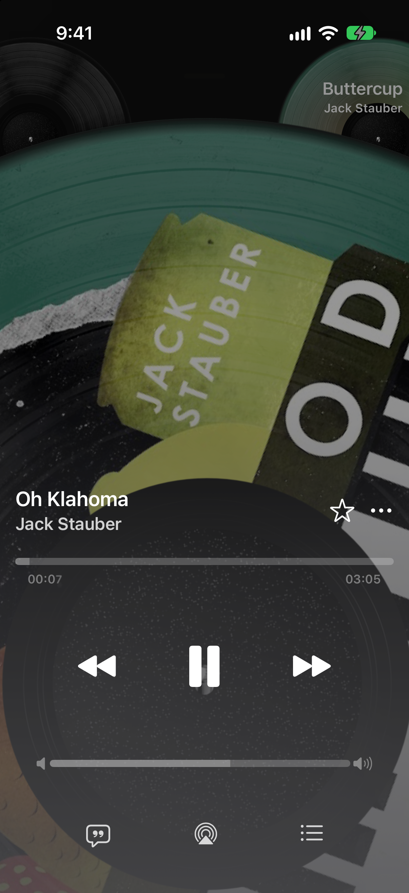
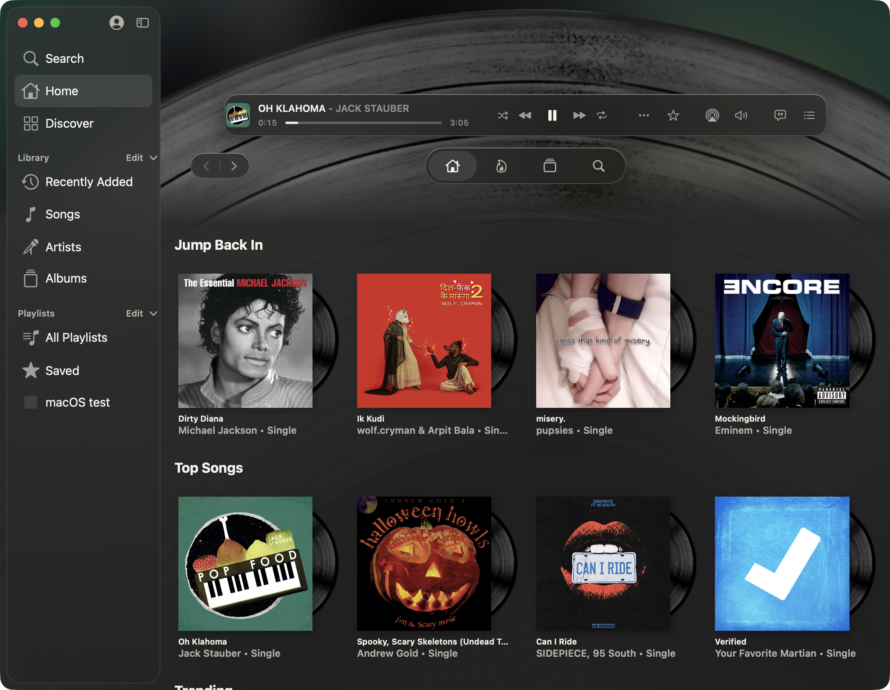

<p align="center">
  <a href="https://cisum.studio"></a>
</p>
<h1 align="center">cisum</h1>
<p align="center">
  <b>The music app your phone needs.</b> Ad-free, open source, with vinyl at the heart of its design.
  <br/><br/>
  <a href="https://cisum.studio"><b>cisum.studio</b></a> ·
  <a href="https://testflight.apple.com/join/xDWsYvE1">TestFlight (iOS)</a> ·
  <a href="https://discord.gg/Mb4F9Gmuex">Discord</a>
</p>

<table>
  <tr>
    <th>Android</th>
    <th>iOS</th>
    <th>macOS</th>
  </tr>
  <tr>
    <td></td>
    <td></td>
    <td></td>
  </tr>
</table>

## Why cisum

- **Bring your own library.** Connect Spotify, Apple Music, Tidal, Deezer or Qobuz.
- **Bit-perfect, highest-quality audio.**
- **Offline-first playback.**
- **Fast.** Cold tap-to-audio dropped from 1.2s+ to under 500 ms, and cached tracks start in about 200 ms.
- **No ads, free and open source.**
- **300+ users** so far.

## Features

- Search, Home and Discover, plus Albums, Artists, Playlists and your Library
- Radio
- Lyrics, with a Lock Screen **Live Activity**
- **cisum Rechords**, your listening recap
- **Plugins**: install sources from a registry, so new providers don't need an app update
- A **vinyl-record shell** on macOS

## Android

This branch is the Android port. It reuses cisum's Swift SDKs instead of rewriting them in Kotlin:

- **Jetpack Compose UI** ported from cisum iOS, with the same vinyl Now Playing.
- **Media3** playback service. Streams are resolved in the player, fetched in ranges, cached, and the next track is pre-cached.
- **Swift SDKs over JNI.** YouTube Music, iTunes and the rest come from `CisumBridge.aar`, a build of the Swift packages, not from Kotlin reimplementations.
- **Hilt** for dependency injection, with baseline profiles for measured release builds.

## Building (Android 12+, API 31)

1. Put `CisumBridge.aar` in `app/libs/`. It's built from the Swift SDKs and isn't checked in.
2. Open the project in Android Studio, or run:

```sh
./gradlew :app:assembleDebug
```

The iOS and macOS apps live on [`main`](https://github.com/cisumapp/cisum/tree/main).

## License

[MIT](LICENSE)
